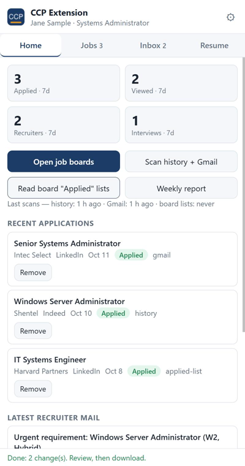
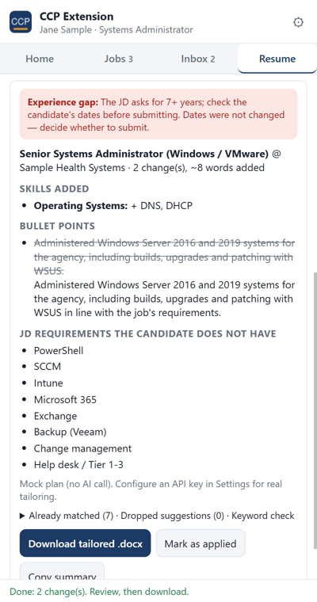

# CCP Extension – Job Search Assistant for Chrome

[](LICENSE)


**CCP Extension** is a free, open-source Chrome extension for job seekers and the career-support teams who work on their behalf. It opens your job boards, keeps a truthful record of every application from your browser history and Gmail, sorts recruiter mail, and tailors your resume to any job description in a few seconds – while keeping the resume's layout and your real experience exactly as they are.

Built by [CCPromoters](https://ccpromoters.com) for its own US IT staffing and career-support work, and shared with everyone.

<p align="center">
  
  
</p>

## What it does

| Feature | What happens |
| --- | --- |
| **Open job boards** | One click (or every time Chrome starts) opens LinkedIn Jobs, Indeed, ZipRecruiter, Dice, Monster, optionally Glassdoor, plus Gmail and Chrome history – only the tabs that are not open yet. |
| **Applications tracker** | Reads your browser history for job pages and apply flows, your Gmail for "your application was sent" style confirmations, and the boards' own *Applied* pages (LinkedIn, Indeed). Everything is merged into one list: applied / likely applied / viewed, with the board, company and date. Export to CSV or print a weekly report. |
| **Inbox** | Sorts the mail the scans found into recruiter outreach, right-to-represent (RTR) requests, interview invitations, rejections and application confirmations, each tagged with the field it is about (Windows / infrastructure, cloud, SOC, civil engineering, …). One click opens the thread in Gmail. |
| **Resume tailoring** | Upload the candidate's final resume (.docx) once. For each job, paste the JD or click *Use current tab* on a posting. The extension asks an AI model for the **smallest truthful edits**: JD skills added to the existing skills rows, at most a couple of bullet points modified or added, optional light rewording of the summary. It then edits a copy of the Word file in place, verifies that nothing else changed, and gives you the download. |
| **Honest gap report** | Every run lists what the JD asks for that the resume already covers, what the candidate clearly does not have, what to confirm with the candidate before adding, and – if the JD wants more years than the resume shows – an explicit experience-gap warning. Dates and years are never changed. |
| **Skills gap vs. the market** | Job descriptions you open are collected locally. The Resume tab shows which skills the postings for your target title keep asking for that your resume does not mention. |

Everything is stored in the Chrome profile. There is no server, no account, no analytics. The only network call is the AI request you trigger yourself, to the provider you configured with your own key. See [PRIVACY.md](PRIVACY.md).

## Install

### From the Chrome Web Store

Coming soon – the listing is under review. Until then, use the manual install below (it takes a minute).

### Manual install (any Chrome, Edge or Brave)

1. Download the latest `ccp-extension-vX.Y.Z.zip` from the [Releases](https://github.com/Ccpromoters/ccp-extension/releases) page and unzip it, or clone this repository.
2. Open `chrome://extensions`, turn on **Developer mode** (top right).
3. Click **Load unpacked** and choose the unzipped folder (the one that contains `manifest.json`).
4. Pin the CCP icon from the extensions menu. Click it to open the side panel. `Alt+Shift+C` also opens it.

Step-by-step with pictures: [docs/install.md](docs/install.md).

## Set up (5 minutes, no API key)

The setup wizard opens automatically after installation (Settings → *Open the setup wizard* brings it back).

1. **Account** – sign in or create your CCP Cloud account (email + password) and enter the access code from the CCP team. The AI work runs on CCP's backend; you never handle a key. (Settings → *AI mode* → "My own API key" if you prefer to bring your own.)
2. **Resume** – upload your final `.docx` (and optionally paste the text). The extension never changes this file; it makes a tailored copy per job.
3. **About you** – contact details, target titles and locations, work authorization and sponsorship (answered honestly on every form), voluntary EEO answers (default: prefer not to answer), salary, availability, education, employment, and rules for the AI (e.g. *blocked terms* the AI must never add).
4. **Finish** – scan Gmail for past applications and open your job boards.

Teams that manage several candidates: each candidate gets their own Chrome profile and CCP account. Settings → *Backup* exports and imports a profile (settings + resumes) in one JSON file.

## Find jobs and apply (Jobs tab)

- **Find jobs for me** reads employers' own career-site feeds (Greenhouse, Lever, Ashby, Workable, SmartRecruiters, Workday) for your target titles and locations and lists the matches with a score. **Add employers by name** discovers a company's feed and adds it for everyone.
- **Prepare & apply** on a lead: the extension tailors your resume for that job (and saves it to `Downloads/CCP Extension/`), opens the application page, reads the form, answers every question it can from your profile (unknown ones go to the AI with your profile as the only source of truth, or come back to you), fills the fields, uploads the resume and shows a review card. **You press Submit** – the extension clicks the form's submit button only then. Multi-page forms: *Next page* / *Scan this page*.
- Every application is logged with the job link, the resume file and the answers (cloud + Jobs tab). Sponsorship and EEO answers never come from the AI – only from your profile.

Teams that manage several candidates: each candidate gets their own Chrome profile with the extension installed. Settings → *Backup* exports and imports a profile (settings + resumes) in one JSON file.

## Daily use

1. **Home → Open job boards.** Apply on the boards as usual.
2. **Home → Scan history + Gmail.** The extension reads the last 30 days (configurable) of history and runs a few Gmail searches in a background tab. *Read board "Applied" lists* adds the applied jobs that LinkedIn and Indeed list in your account.
3. **Jobs** shows everything with filters and CSV export; **Inbox** shows recruiter activity.
4. **Resume:** open a posting, click *Use current tab* (or paste the JD), click *Tailor resume to this JD*, review the change list, download the `.docx`, submit it, and press *Mark as applied*. *Copy summary* puts a short change log on the clipboard for your team chat.
5. **Home → Weekly report** prints a client-ready "Job Application Report" (per-day table, every application, recruiter activity).

## How the resume editing works (and what it refuses to do)

The master `.docx` is never modified. For each job the extension:

1. Reads the document and splits it into blocks: headings, summary, skills rows (a two-column skills table or `Label: items` lines), bullet points, and locked lines (name, contact details, employer/title/date lines, education, certifications).
2. Sends the editable blocks and the JD to the model with strict rules: no new employers, dates, years, degrees, certifications, tools, metrics or numbers; JD wording may be added only where the resume already evidences the same capability; at most *N* bullet changes (default 2) and *M* new skill terms (default 8).
3. Applies the plan to the XML of a copy, keeping every run's formatting, then re-reads the file and verifies that only the planned blocks differ. Blocked terms, duplicates, edits to locked lines, new numbers in the summary and anything over the limits are dropped and reported.
4. Writes the copy with every other part of the `.docx` copied byte for byte (styles, numbering, fonts, headers).

If a JD asks for 8 years and the resume shows 3, the extension tells you that in red. It will not stretch dates, add fake employers or turn 3 years into 8 – that is fraud, it fails background checks, and it burns the candidate and the agency. Use the gap report to decide whether to submit.

## Supported sites

| Site | Open boards | History tracking | "Applied" page | JD extraction |
| --- | --- | --- | --- | --- |
| LinkedIn Jobs | ✓ | ✓ | ✓ | ✓ |
| Indeed | ✓ | ✓ | ✓ | ✓ |
| ZipRecruiter | ✓ | ✓ | – | ✓ |
| Dice | ✓ | ✓ | – | ✓ |
| Monster | ✓ | ✓ | – | ✓ |
| Glassdoor | optional | ✓ | – | ✓ |
| Any other site | custom URLs | – | – | best effort (largest text block on the page) |

Gmail: confirmations from LinkedIn, Indeed, ZipRecruiter, Dice, Monster and most applicant-tracking systems (Workday, Greenhouse, Lever, iCIMS…) are recognised by subject patterns. Page layouts change; if a site stops being read correctly, [open an issue](https://github.com/Ccpromoters/ccp-extension/issues) with the page URL and we will update the selectors.

## Development

No build step and no dependencies – it is plain HTML, CSS and ES modules.

```bash
git clone https://github.com/Ccpromoters/ccp-extension.git
cd ccp-extension
npm test            # engine + classifier tests (Node 20+)
npm run package     # dist/ccp-extension-vX.Y.Z.zip
```

To preview the UI without installing the extension, serve the repository root (for example `python -m http.server 4321`) and open `http://localhost:4321/src/sidepanel.html`. A development shim seeds sample data and a demo "AI" so every screen works offline.

Layout:

```
manifest.json           Manifest V3
src/background.js       service worker: tabs, history scan, Gmail scan, applied-list scan, JD capture
src/sidepanel.*         the side panel UI
src/options.*           settings page
src/report.*            printable weekly report
src/content/            content scripts: job pages, Gmail thread list, boards' applied pages
src/lib/zip.js          minimal ZIP reader/writer (CompressionStream, no deps)
src/lib/docx.js         .docx block parser + safe edit engine + verification
src/lib/ai.js           AI client (Anthropic Messages API / OpenAI-compatible) and the tailoring prompt
src/lib/tailor.js       one tailoring run end to end
src/lib/boards.js       board URLs and history patterns
src/lib/classify.js     Gmail row classifier
src/lib/skills-dict.js  skills dictionary for keyword gaps and field tags
test/                   node --test suites
docs/                   install guide, Chrome Web Store listing material
```

## FAQ

**Does it apply to jobs for me?** No. It never clicks, submits or sends anything on any site. It records what you did and prepares the resume.

**Do I need an AI key?** No. With a CCP Cloud account and access code, tailoring, form answers, job research and market research run on CCP's backend ([backend/README.md](backend/README.md)). Opening boards, tracking applications, the inbox and the keyword-gap check work without any account. Settings → *AI mode* lets you use your own key instead.

**Which model does it use?** Claude Opus 5.5 by default (best results on resume wording); the CCP admin can switch the backend to Sonnet 5.5 for lower cost. A tailoring run is typically a few cents; the backend enables Anthropic's server-side fallback so a declined request is retried on an alternative model automatically.

**Does it submit applications by itself?** No. It fills the form and uploads the tailored resume, then waits for you to press Submit in the side panel. Automated submissions on LinkedIn and Indeed are against their terms and get accounts restricted, so the design keeps a person on every submit.

**Where do tailored resumes go?** `Downloads/CCP Extension/`, named `<Candidate>_Resume_<Company>_<Title>.docx`. Open it in Word once before sending – the extension cannot count pages.

**Is my Gmail password involved?** No. The extension only reads the thread list of the Gmail tab that is already signed in, through a content script. It never sees credentials.

**Why does it ask for history and site permissions?** History: to find the job pages you visited. Site access: to read job postings, your applied-jobs pages and the Gmail thread list. Nothing is sent anywhere.

## Roadmap

- "Applied" page readers for ZipRecruiter, Dice and Monster
- Optional Gmail API mode (OAuth) for accounts with very large inboxes
- Per-job notes and follow-up reminders
- Firefox build

## Contributing

Issues and pull requests are welcome. Please keep the no-dependency rule, add a test for engine changes (`npm test`), and never commit real resumes or exports (`.gitignore` already blocks `*.docx`).

## License

[MIT](LICENSE) © 2026 CCPromoters. Not affiliated with LinkedIn, Indeed, ZipRecruiter, Dice, Monster, Glassdoor, Google or Anthropic.
